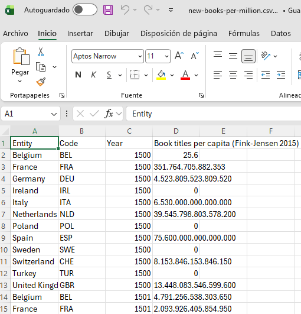
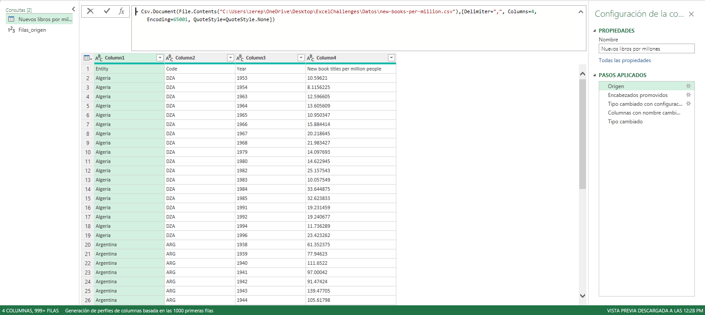
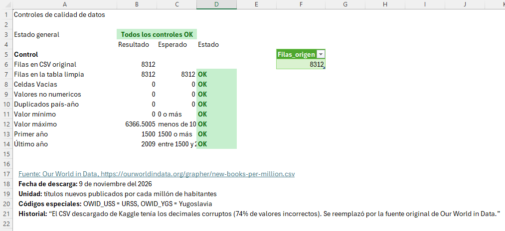
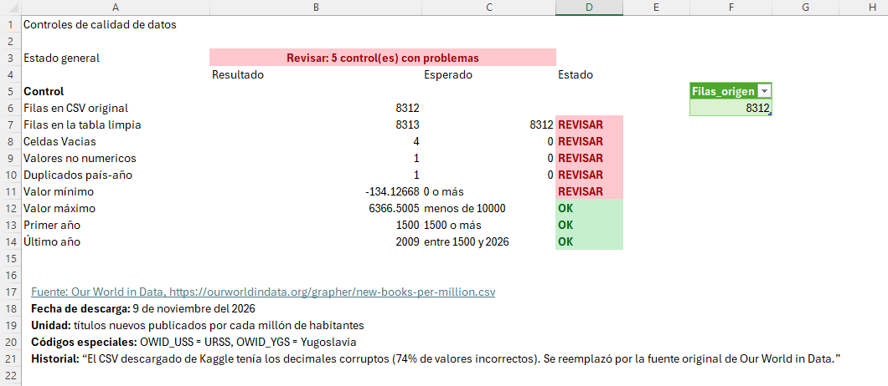
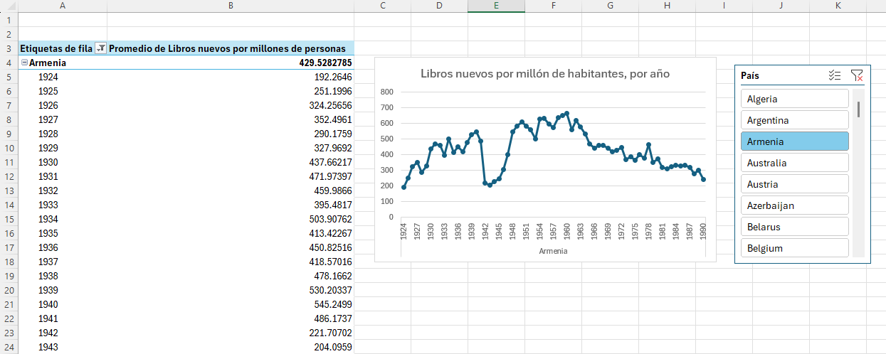

# 📚 Libros nuevos por millón de habitantes: caso de depuración de datos

**Herramientas:** Microsoft Excel · Power Query · Tablas dinámicas · Segmentadores · Fórmulas de control
**Autor:** Antony Pérez Parrales
**Tipo de proyecto:** proyecto de práctica con datos públicos

---

## Resumen

Al trabajar con un dataset público sobre la publicación de libros por país, descubrí que **el 74% de los valores estaban corruptos**: los decimales se habían perdido y los números quedaron multiplicados o divididos por 10, 100 o más. Identifiqué la causa, reemplacé los datos por la fuente original y construí un proceso automatizado en Power Query con una hoja de controles que verifica la calidad de los datos cada vez que se actualiza.

---

## 1. El problema

Descargué de Kaggle una versión del dataset *New book titles per million people*. Al cargarlo y graficarlo, las series mostraban saltos imposibles. Por ejemplo, Austria:

| Año | Valor en el CSV de Kaggle | Valor real |
|---|---|---|
| 1958 | 4.416.786.191.219.800 | 441.68 |
| 1959 | 387.827.135.102.924 | 387.83 |
| 1960 | 4.637.644.103.766.170 | 463.76 |

*El CSV de Kaggle abierto en Excel: los puntos aparecen cada tres cifras y el decimal real se perdió.*

**Causa:** el archivo había sido guardado con una configuración regional que usa el punto como separador de miles. Los puntos se insertaron cada tres cifras y la posición real del decimal se perdió. Al comparar contra la fuente original, solo **2,134 de 8,312 registros (26%)** se podían interpretar correctamente.

**Conclusión clave:** estos datos no se podían reparar desde el propio archivo, porque la información del decimal ya no existía. La solución correcta era volver a la fuente.

---

## 2. El proceso

### Datos
- **Fuente original:** [Our World in Data](https://ourworldindata.org/grapher/new-books-per-million.csv)
- **Registros:** 8,312
- **Cobertura:** 71 países y entidades, entre los años 1500 y 2009
- **Unidad:** títulos nuevos publicados por cada millón de habitantes

### Power Query
La consulta lee el CSV directamente desde la carpeta del proyecto y aplica estos pasos:

1. **Origen:** lectura del CSV con codificación UTF-8 (65001).
2. **Encabezados promovidos.**
3. **Cambio de tipo con configuración regional Inglés (EE. UU.):** garantiza que el punto se interprete como decimal en cualquier computadora, sin importar su configuración regional.
4. **Columnas renombradas al español:** País, Código, Año, Libros nuevos por millón de personas.
5. **Año convertido a número entero.**

Una segunda consulta, `Filas_origen`, cuenta las filas del CSV original para compararlas con el resultado final.

*Consulta en Power Query: lectura del CSV con codificación UTF-8 y pasos aplicados.*

### Hoja de controles
Verificaciones automáticas que se recalculan al actualizar:

| Control | Qué verifica |
|---|---|
| Filas en la tabla limpia | Que coincidan con las filas del CSV original (no se perdió ni duplicó nada) |
| Celdas vacías | Que no haya datos faltantes |
| Valores no numéricos | Que todos los valores sean números válidos |
| Duplicados país-año | Que cada país aparezca una sola vez por año |
| Valor mínimo y máximo | Que estén en un rango razonable (sin negativos ni valores absurdos) |
| Primer y último año | Que no haya años imposibles |

Una celda de **estado general** resume todos los controles en un solo mensaje.

*Hoja de controles con los datos correctos: todos los controles en verde.*

**Prueba de los controles:** alteré a propósito una copia del CSV (valores negativos, filas eliminadas y filas duplicadas), apunté la consulta a esa copia y confirmé que cada control detectaba su error correspondiente.

*Prueba con datos alterados a propósito: los controles detectan la fila extra, las celdas vacías, el valor no numérico, el duplicado y el valor negativo.*

### Visualización
- Tabla dinámica con el **promedio** por país y año.
- Gráfico de líneas con la tendencia por año.
- Segmentador para filtrar por país.

---

## 3. Resultado

- **8,312 registros verificados**, idénticos a la fuente original.
- Proceso **automatizado**: al reemplazar el CSV por una versión nueva, basta con *Datos > Actualizar todo*.
- **Todos los controles en verde.**

*Tabla dinámica, gráfico y segmentador por país. En Armenia se observa una caída marcada entre 1942 y 1945, durante la Segunda Guerra Mundial.*

---

## 4. Errores encontrados en el camino y cómo los resolví

Documento también los errores que cometí durante el proyecto, porque fueron parte del aprendizaje:

| Error | Causa | Solución |
|---|---|---|
| Valores con magnitudes incorrectas | Intenté reparar los números tomando el texto antes del segundo punto, sin saber que la posición del decimal se había perdido | Reemplazar los datos por la fuente original |
| La tabla dinámica sumaba una tasa | Sumar "libros por millón" de varios años no tiene significado | Cambiar el resumen a **Promedio** |
| El control "Primer año" daba 0 | Al quitar un paso automático de Power Query, la columna Año quedó como texto y `MIN` la ignoraba | Convertir Año a número entero y mejorar el control para detectar el caso |
| La tabla dinámica perdió su columna de valores | Cambié el nombre de la columna en Power Query y la tabla dinámica dejó de encontrarla | Volver a agregar el campo y revisar la presentación después de cada cambio en la consulta |

---

## 5. Aprendizajes

- **Nunca confiar en un dataset sin verificarlo contra su origen.** Un archivo puede verse bien y estar dañado.
- **Abrir un CSV en un editor de texto antes que en Excel** permite ver los separadores reales.
- **Las tasas no se suman**: el tipo de resumen depende de lo que mide el dato.
- **Un control que siempre da verde no sirve**: hay que probarlo con datos alterados a propósito.
- **Cualquier cambio en el origen puede romper lo que depende de él**, como tablas dinámicas y gráficos.

---

## Cómo usar el archivo

1. Descarga la carpeta completa del proyecto (el Excel y la carpeta `Datos`).
2. Abre el Excel y ve a *Datos > Obtener datos > Configuración de origen de datos*.
3. Selecciona la ruta del CSV, haz clic en **Cambiar origen** y apunta al archivo `Datos/new-books-per-million.csv` en tu computadora.
4. Presiona *Datos > Actualizar todo*.
5. Revisa la hoja **Controles**: debe decir *Todos los controles OK*.

---

## Mejoras pendientes

- Leer la ruta del CSV desde una celda como parámetro, para que no haya que cambiarla manualmente.
- Agregar un control que detecte saltos bruscos entre años consecutivos de un mismo país.
